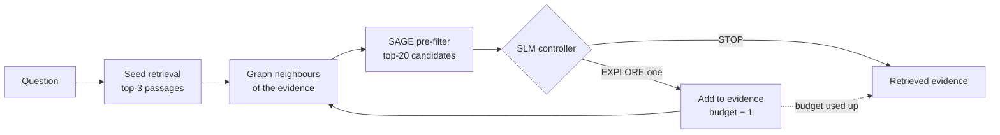
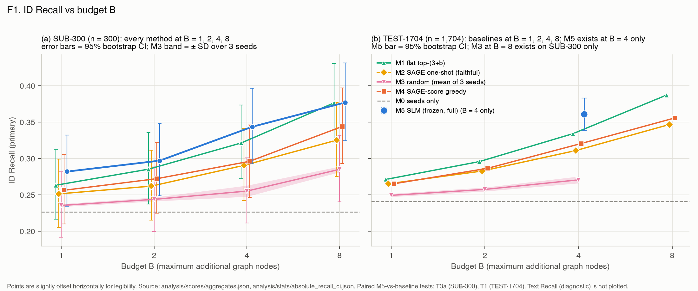

# Budget-Aware Training-Free RAG

**Can a small language model, with no training, decide which documents to read next and when to stop?**

Multi-hop questions often need evidence that a single search doesn't return. The answer may sit one or two links away in a graph of related passages. Following every link is expensive, and a fixed rule follows the wrong ones. This project gives that decision to a small pretrained language model (SLM). The SLM looks at the question, the evidence gathered so far and a short list of neighbouring passages. At each step it either **explores one passage** or **stops**, under a fixed budget of how many passages it may add.

No fine-tuning and no reinforcement learning are involved: the model is used off the shelf.

> CSE 576 · Project C · built on [SAGE](https://github.com/CoRAL-ASU/sage) (Structure-Aware Graph Expansion) · OTT-QA documents · Qwen3-4B-Instruct (4-bit, MLX), running locally on an M3 MacBook Air

---

## How it works

1. **Seeds.** A hybrid dense + BM25 search (SAGE's own) finds three starting passages.
2. **Candidates.** The graph neighbours of everything retrieved so far are ranked by SAGE's similarity score, and the top 20 are shown to the model.
3. **Decision.** The SLM replies with a single structured action: `{"action": "EXPLORE", "node_id": "A3"}` or `{"action": "STOP"}`.
4. **Repeat** until the model stops, the budget runs out, or there's nothing left to explore.

Every method we compare uses the same graph, the same seeds and the same candidate lists. The only thing that changes is **who picks the next passage**.

## What we compared

| | Method | How it picks the next passage |
|---|---|---|
| **M5** | **SLM controller (ours)** | The model chooses, and can stop early |
| M4 | SAGE-score greedy | Always takes the top-ranked candidate |
| M3 | Random | A random candidate from the top 20 |
| M2 | Original SAGE expansion | Adds the best-scoring neighbours of the seeds in one shot |
| M1 | Flat retrieval | Ignores the graph and takes more search results |
| M0 | Seeds only | No expansion |

We also removed one piece of the controller at a time: its **history**, the **budget** shown to it, and its ability to **stop**.

## Findings

  

**1. The model picks better passages than the fixed rules.**
- With a budget of 4 passages, the SLM found more of the gold evidence than every baseline:
  - **0.36 recall**, against 0.33 for flat search, 0.32 for SAGE-score greedy, 0.31 for SAGE's original expansion, and 0.27 for random.
- It held on a set of 1,654 questions we had never scored before.
- It often passes over the pre-filter's top choice (only about 40% of its picks are rank 1), and on balance those choices pay off.
- Most of the gain comes from questions where the gold passage is close by: there, its recall is 0.53 against 0.38 for the score-based rule.

**2. It also follows chains beyond direct neighbours.** It retrieved more gold passages two or more hops from the seeds than the score-based traversal did.

**3. Stopping saves effort, at a very small price.**
- The model stopped early on about 1 in 9 questions, using about 7% fewer expansions and 9% fewer tokens.
- Forcing it to keep going recovered gold on only 9 of those 187 questions.
- But stopping isn't a precise "I have enough" signal: only about 40% of stops happened with all the gold already found.

**4. On the frontier for passages added, but slow in wall-clock time.**
- More budget keeps helping: recall rises from 0.28 to 0.38 as the budget grows from 1 to 8.
- At every budget we tested, the SLM sits on the recall-versus-passages-added Pareto frontier.
- Its inference cost makes it much less competitive in wall-clock time: about 36 s per question at budget 4 on a laptop. A score-based traversal with twice the budget reaches the same recall in about a third of the time.

**5. Two controller inputs didn't show a measurable effect.** Removing the traversal history, or hiding the remaining budget, changed recall by less than our 300-question ablation set can resolve.

**6. It's reliable.** Thousands of decisions produced zero malformed or invalid outputs.

**Where this falls short**
- **Absolute recall stays low.** For about half the questions, none of the remaining gold is reachable within one hop of the seeds, and no traversal policy can fix that.
- **Flat search is a strong baseline.** It stays close to the SLM, and on the 300-question budget sweep the difference between them isn't resolved.
- **The evidence base is narrow:** one dataset, one model and one prompt.

The paired statistics, per-budget comparisons and every caveat are in [`RESULTS_INTERPRETATION.md`](RESULTS_INTERPRETATION.md).

## Repository guide

| Read this | For |
|---|---|
| [`RESULTS_INTERPRETATION.md`](RESULTS_INTERPRETATION.md) | The full findings, organised by research question |
| [`analysis/tables/TABLES.md`](analysis/tables/TABLES.md) · [`analysis/figures/`](analysis/figures/) | Tables T1–T6 and figures F1–F5 |
| [`EXPERIMENT_PLAN.md`](EXPERIMENT_PLAN.md) · [`ANALYSIS_PLAN.md`](ANALYSIS_PLAN.md) | What was run, and how it was scored and tested |
| [`Project_C_Updated_Phase_Wise_PRD.md`](Project_C_Updated_Phase_Wise_PRD.md) | Project scope and research questions |

<b>Code layout</b>

| Directory | Contents |
|---|---|
| `graph_reconstruction/` | Rebuilds SAGE's document graph on CPU (21,742 passages, ~397k edges) |
| `seed_retrieval/` | SAGE's hybrid seed search |
| `traversal_adapter/` | Node, neighbour and seed lookup over the graph |
| `candidate_prefilter/` | SAGE's similarity pre-filter |
| `slm_controller/` | Prompt, output parser, MLX backend |
| `adaptive_traversal/` | The traversal loop and the pilot runs |
| `baselines/` | Score-greedy and random traversal |
| `experiments/` | Frozen experiment registry, resumable runner, ablations, run manifests |
| `analysis/` | Integrity checks → scoring → statistics → tables → figures |

<b>Reproducibility and what isn't included</b>

All methods, prompts and settings were frozen before the final runs. `experiments/FROZEN.json` records hashes of the code, data, model and libraries, and every analysis step checks the outputs of the step before it.

Left out of the repository for size, and available on request:
- the reconstructed graph and its caches;
- seed and pre-filter rankings;
- per-question experiment outputs and scores.

Also needed but not included:
- the SAGE code: [CoRAL-ASU/sage](https://github.com/CoRAL-ASU/sage) at commit `405d5f5`;
- the SAGE artifacts: Hugging Face `prasham1515/SAGE`.

Without the large files, the analysis scripts stop at their input checks. The committed tables and figures are the final results.

**Environment:**
- Python 3.13, with `mlx` 0.32.4, `mlx-lm` 0.32.2, `torch` 2.14.1, `sentence-transformers` 6.1.0.
- Model: `mlx-community/Qwen3-4B-Instruct-2507-4bit` at revision `50d4277`, greedy decoding.
- Run commands are in [`experiments/README.md`](experiments/README.md).

